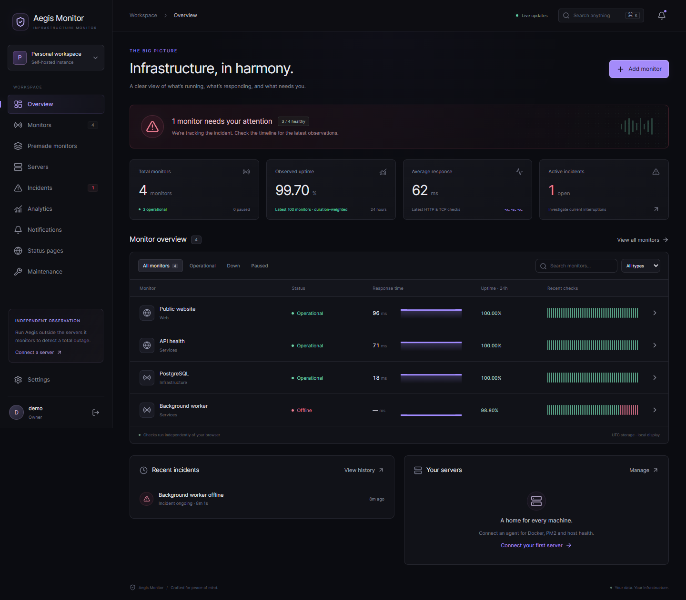
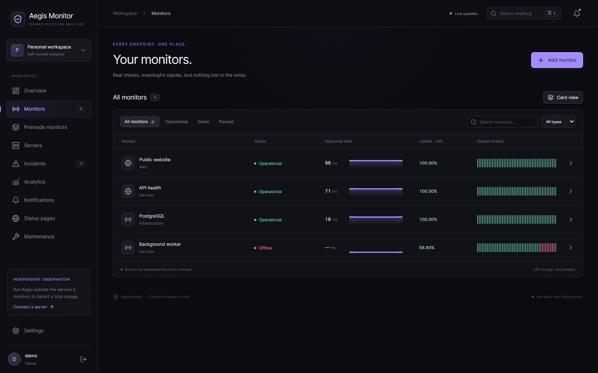
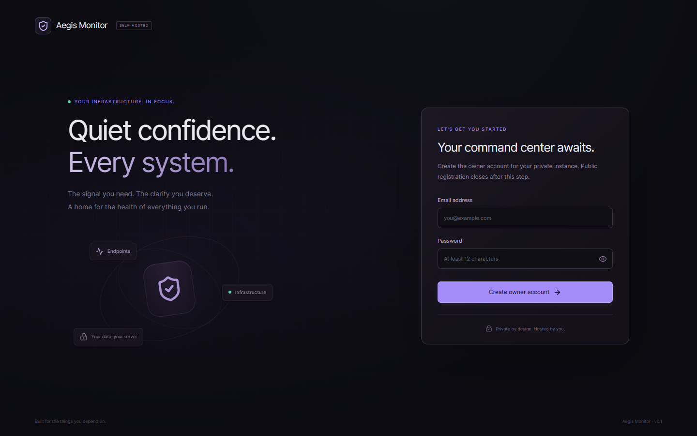

# Aegis Monitor

**Self-hosted uptime monitoring for the services and servers you run.**

Rust checks and agents · PostgreSQL history · SvelteKit dashboard · Public status pages

[Get started](#self-host-in-5-steps) · [Full screenshot gallery](docs/screenshots/README.md) · [Features](#features) · [Troubleshooting](#troubleshooting) · [Documentation](#documentation)

> [!NOTE]
> Aegis is a single-workspace deployment with one active API scheduler. Review the [current limitations](docs/limitations.md) before using it for critical alerting. A separate observer is needed to detect a complete outage of the machine hosting Aegis.

## At a glance

| | |
| --- | --- |
| **Checks** | HTTP/HTTPS, JSON API, TCP, DNS, TLS, Redis PING, SMTP greeting, PostgreSQL handshake, push heartbeats, Docker, PM2 and host resource checks |
| **Alerts** | Durable Discord, JSON webhook and SMTP email deliveries with routing, retries, cooldowns and SLO budget alerts |
| **Status** | Public-safe resources, branded status pages, incidents, maintenance, uptime and RSS |
| **Host** | Linux with Docker Engine and Compose 2.24.4+; production HTTPS through Caddy |
| **Storage** | PostgreSQL 17; no Redis service required |
| **License** | [GNU AGPL v3](LICENSE) (`AGPL-3.0-only`) |

## Screenshots

These are captures of the **real Svelte interface with synthetic example data**. They do not show a production instance or actual uptime.

**[Browse all 38 screenshots →](docs/screenshots/README.md)** Every workspace page, public status tab, and the main monitor, incident, notification, status page, resource, maintenance, and server configuration views are shown there.

<strong>Monitor list</strong> — status, latency, uptime and recent checks

<strong>First-run setup</strong> — create the owner account

## Self-host in 5 steps

This is the shortest path to a **local, loopback-only** instance. Use a Linux host with Docker Engine, Compose 2.24.4 or newer, and at least 2 GB free RAM (4 GB or more while building). Only the gateway is published, on `127.0.0.1:8080`.

### 1. Get the project

~~~sh
git clone https://github.com/F34R23232323/Aegis-Uptime-Monitor.git
cd Aegis-Uptime-Monitor
~~~

If you already have the source, run the remaining commands from its root directory.

### 2. Make your environment file

~~~sh
cp .env.example .env
openssl rand -hex 24   # Copy into POSTGRES_PASSWORD
openssl rand -hex 32   # Copy into ENCRYPTION_KEY
~~~

Edit `.env` and paste the **two independently generated values**. Keep the file private and out of Git. Leave `APP_URL=http://localhost:8080` for this local setup. If you change `PORT`, change `APP_URL` to the exact browser origin too, with no trailing slash.

### 3. Build and start

~~~sh
docker compose config --quiet
docker compose up -d --build
docker compose ps
~~~

The first build can take several minutes. The API applies database migrations before it becomes ready.

### 4. Open the dashboard

On the host, visit **[http://localhost:8080](http://localhost:8080)**. For a remote Linux server, keep the loopback binding and tunnel from your own computer:

~~~sh
ssh -L 8080:127.0.0.1:8080 user@your-server
~~~

Then visit `http://localhost:8080` locally. Create the first **Owner** account with a password of at least 12 characters. Public account creation closes after that first setup.

### 5. Add a monitor

Go to **Monitors → Add monitor**, choose HTTP/HTTPS or TCP, enter the target, run **Test connection**, then save. Checks start at a minimum 20-second interval; the default incident thresholds require two failures to go down and two successes to recover. The dashboard, incident history and monitor detail update from server-side checks even when the browser is closed.

> [!IMPORTANT]
> Private/LAN/loopback targets are blocked by default. Set `ALLOW_PRIVATE_TARGETS=true` only if trusted administrators should be able to probe networks reachable from the API container. Restart the API after changing it. For a public or shared installation, also consider network egress rules.

## Put it on a public HTTPS domain

Use this path after the local flow is understood. You need a domain pointing at the Linux host and inbound TCP 80/443 (UDP 443 is optional). The production overlay replaces the loopback gateway port with Caddy, which obtains and renews certificates when DNS and networking are set up correctly.

1. In `.env`, set `AEGIS_DOMAIN=status.example.com`, `APP_URL=https://status.example.com` and `APP_ENV=production`. Keep the database and encryption secrets from the local setup or generate them for a fresh installation.
2. Generate a separate setup token with `openssl rand -hex 32` and put it in `BOOTSTRAP_TOKEN`. Do not place it in a command line, screenshot or log.
3. Start the production stack:

   ~~~sh
   docker compose -f compose.yaml -f compose.production.yaml config --quiet
   docker compose -f compose.yaml -f compose.production.yaml up -d --build
   ~~~

4. Open your HTTPS domain and enter the bootstrap token while creating the first Owner. After setup, remove `BOOTSTRAP_TOKEN` from `.env` and recreate the API with the same Compose files:

   ~~~sh
   docker compose -f compose.yaml -f compose.production.yaml up -d --force-recreate api
   ~~~

Existing installations need a database and matching encryption-key backup before upgrading. Follow the [upgrade and backup guide](docs/operations.md#status-platform-upgrade). Never use `docker compose down -v` during an upgrade: it deletes the PostgreSQL volume. The API, web app and database should remain private behind the supplied gateway.

## Features

<strong>Checks and uptime</strong>

- HTTP GET/HEAD checks with expected status, optional keyword matching and bounded redirects; JSON API checks with JSON Pointer assertions.
- TCP, DNS (A, AAAA, CNAME, MX, TXT, NS, SRV), TLS certificate/expiry, Redis PING, SMTP greeting and PostgreSQL SSL negotiation probes. The fixed protocol probes test reachability or handshake, not a database query or email delivery.
- Push heartbeats with one-time secret URLs for cron jobs and external tasks. Keep push URLs out of source control and shared logs.
- Failure and recovery thresholds, bounded retries, pause, maintenance, check history, latency and coverage-aware uptime. Unknown time is not shown as 100% uptime.
- Optional monitor dependencies defer child DOWN notifications while their parent monitor is DOWN; child incidents and measured checks remain visible.
- Raw-check retention is configurable per monitor from 7 to 365 days; the default is 90 days.

<strong>Servers, Docker and PM2</strong>

- Outbound Rust agents report host CPU, memory, disk and network snapshots. CPU, memory and disk percentages are stored in five-minute buckets for history charts. They need outbound HTTPS to Aegis, not an inbound port.
- Optional Docker and PM2 discovery. Choose individual services or host health to create monitors; discovery alone does not generate checks or alerts.
- Missing agent heartbeats affect associated monitors. A running container without a Docker HEALTHCHECK is only a liveness signal; add HTTP/TCP checks for application health.
- Docker socket access is effectively host-level access, even with a read-only mount. See [agent deployment](deploy/agent-hetzner.md) and [safe Docker access](docs/operations.md#safe-docker-access).

<strong>Notifications and incidents</strong>

- Discord embeds with validated templates, preview, event routing, monitor selection, mention controls, failure cooldowns, UTC quiet hours, delayed DOWN escalation, repeat reminders and SLO budget alerts; generic JSON webhooks and SMTP email channels are also supported. Email delivery requires API-side `SMTP_HOST`, `SMTP_FROM` and optional SMTP credentials in `.env`.
- **Send test** queues a real delivery. Saving a channel or previewing an embed does not send one.
- Durable jobs retry provider failures across restarts. Delivery is at least once, so a crash at the wrong moment can repeat a provider message.
- Automatic measured incidents stay private until you explicitly publish safe editorial text to a selected status page. Visitors can confirm email subscriptions for published incident updates when SMTP is configured and the page permits subscriptions.

<strong>Public status pages</strong>

- Public-safe resources can combine eligible monitors, use manual status overrides with reasons and expiry, and show measured uptime only where evidence exists.
- Brand pages with a slug, theme, accent, logo, labeled support link, announcement, optional footer and ordered Overview, Incidents, Maintenance, Metrics or plain-text tabs. The editor shows a live draft preview of page appearance and selected content.
- Publish incident updates and maintenance notices selectively. Public pages exclude targets, credentials, raw errors, private notes and host inventory.
- Server-rendered page: `/status/<slug>`. RSS feed: `/api/v1/public/status/<slug>/feed`.
- Premade component choices are available for several public provider status feeds. Provider-reported status can lag or differ from local availability; see the [scope and limitations](docs/limitations.md).

<strong>Security and operations</strong>

- One-time first-owner enrollment, Owner/Admin/Viewer roles, Argon2id passwords, optional authenticator verification, revocable sessions, exact-Origin mutation checks and encrypted saved webhook/monitor credentials.
- Same-origin API requests, public-safe API projections, bounded probes, private-target policy and a production HTTPS profile.
- Guarded backup/restore scripts, internal health endpoints and an optional bearer-protected Prometheus aggregate exporter.
- A single active scheduler is enforced by a PostgreSQL advisory lock. Run an independent observer if you need to detect the Aegis host's complete outage.

## Day-two operations

| Task | Command or location |
| --- | --- |
| Check health | `docker compose ps` and `docker compose logs --tail=100 api web gateway` |
| Stop without deleting data | `docker compose down` |
| Upgrade | Back up DB and encryption key; review [operations](docs/operations.md); rebuild with the same Compose files and project/volumes |
| Back up | `deploy/bin/backup /absolute/secure/path/aegis.sql.gz`; encrypt and store off-host |
| Restore | `deploy/bin/restore --into-empty-database /absolute/secure/path/aegis.sql.gz` with API stopped |
| Agent enrollment | **Servers → Connect server**; save the one-time token and follow [agent setup](deploy/agent-hetzner.md) |
| Account recovery | Use the documented owner CLI flow in [operations](docs/operations.md), not an email reset form |

For production, include `-f compose.yaml -f compose.production.yaml` in Compose commands. Keep the encryption key with the matching database backup: changing it without re-encrypting stored credentials makes them unreadable. Changing `POSTGRES_PASSWORD` in `.env` does not alter an existing PostgreSQL role.

## Troubleshooting

<strong>Containers fail to start or stay unhealthy</strong>

Run `docker compose ps` and `docker compose logs --tail=150 db api web gateway`. Confirm both required secrets are set in `.env`, the host has enough free RAM and disk, and the database becomes healthy. The API waits for migrations. Do not delete the data volume to repair startup.

<strong>Login fails with an Origin or cookie error</strong>

`APP_URL` must match the browser's scheme, hostname and port exactly, without a trailing slash. For production, use the HTTPS domain and the production Compose overlay; for local setup, use `http://localhost:8080` or an SSH tunnel to it. Recreate the API/web containers after changing the origin.

<strong>Monitor stays pending, unknown or down</strong>

Check the monitor target, DNS and outbound connectivity from the API host, failure/recovery thresholds and `docker compose logs api`. Private/reserved addresses require the deliberate `ALLOW_PRIVATE_TARGETS` opt-in. HTTP redirects can be bounded and validated; verify the final target. Unknown coverage is never counted as healthy.

<strong>Agent is offline or Docker/PM2 inventory is missing</strong>

Verify agent HTTPS trust, token, outbound firewall and `journalctl -u aegis-agent -f`. The systemd service must run as the correct PM2 user with accessible homes and a valid PM2/Node path. Docker discovery needs explicit opt-in and a carefully controlled local Docker API. The isolated Compose agent reports container/namespace metrics, not full host metrics.

<strong>Discord/webhook delivery is pending or failed</strong>

Inspect **Notifications → Delivery history**, the provider URL and permissions, and provider rate limits. A test action queues delivery; it does not promise immediate acceptance. Saved webhook secrets are not returned by GET APIs. Failed jobs can be retried after the destination is repaired.

<strong>Public page does not show a monitor or incident</strong>

Mark the monitor public eligible, link it to a public-safe resource, and select that resource on the page. Publish incidents explicitly to the intended page with safe copy. Resource overrides affect presentation but do not create check evidence. Public content refreshes about every 30 seconds.

## Development

Rust development needs a C compiler and stable Rust 1.100+. The web app needs Node 24. Native integration tests use a disposable PostgreSQL 17 database with a role able to create temporary databases. The Vite dev server proxies `/api` to Rust on `127.0.0.1:3001`.

~~~sh
# Repository root
cargo fmt --all --check
cargo clippy --workspace --all-targets --locked -- -D warnings
cargo test --workspace --locked

# apps/web
npm ci
npm run lint
npm run check
npm run test
npm run build
~~~

See [verification](docs/verification.md) for previously executed checks and their limits. Playwright E2E creates persistent records and must run only against a disposable instance. To regenerate README screenshots, start Vite from `apps/web`, install Playwright Chromium with `npx playwright install chromium`, then run `node scripts/capture-readme.mjs` there. The capture script intercepts API requests with synthetic data and does not need a real account or database.

## Documentation

- [Architecture and uptime semantics](docs/architecture.md)
- [API routes and request contracts](docs/api.md)
- [Operations, configuration and backups](docs/operations.md)
- [Security and trust boundaries](docs/security.md)
- [Verification record](docs/verification.md)
- [Known limitations](docs/limitations.md)
- [Change history](CHANGELOG.md)
- [License](LICENSE)
